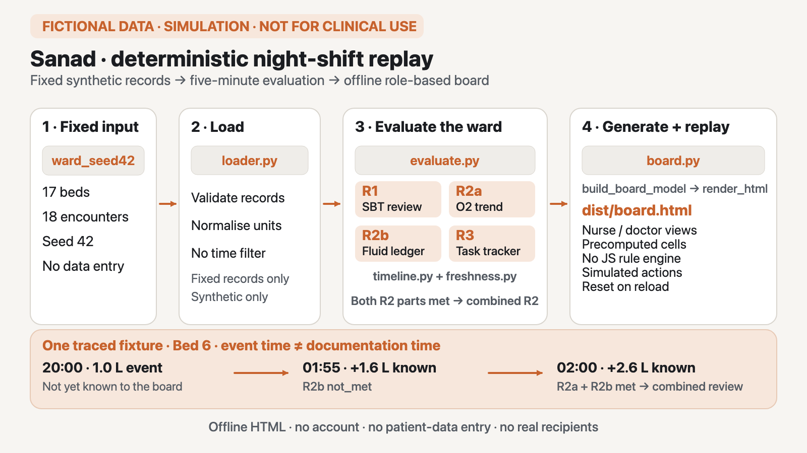

# Sanad

> **FICTIONAL DATA · SIMULATION · NOT FOR CLINICAL USE**

**On the fixed fictional night, the rules were met 657 times; Sanad sent 11 messages: one per episode.**

*Software behaviour on fictional data, not a clinical result.* 657 of 9,848 rule checks came back `met`; the board raised 9 messages for the on-call doctor and 2 for the night nurse. Source: [`eval/results/alert-burden.json`](eval/results/alert-burden.json), written by [`scripts/alert_burden.py`](scripts/alert_burden.py) and re-checked against the engine by [`tests/test_alert_burden.py`](tests/test_alert_burden.py) in CI.



Reproduce the count from the repository root (Python 3.12, standard library only, under a minute):

```bash
python3 -I scripts/alert_burden.py --check
```

To try the board itself, open the [live page](https://drahmed7887.github.io/sanad-public/) (no install, no account) or generate it locally as shown [below](#generate-and-open-the-local-demo). [`JUDGES.md`](JUDGES.md) maps each Kiroween judging criterion to the file, test or screen that proves it.

Sanad is an offline demonstration of sourced night-shift review rules and simulated notification workflows, replayed on a fixed fictional 17-bed adult ICU ward. A deterministic Python engine evaluates the scenarios; a self-contained HTML board lets a viewer step through the night in five-minute increments.

Workflow sources and portrait format: [landscape SVG](docs/workflow.svg) · [4:5 PNG](docs/workflow_4x5.png) · [4:5 SVG](docs/workflow_4x5.svg).

Built with Kiro for **Kiroween 2026, Frankenstein category**. The runtime uses the Python standard library, HTML, CSS and vanilla JavaScript; the generated board needs no server, account or network connection.

## Intended use

> Offline software demonstration using fictional adult ICU scenarios. Illustrates configurable rules and notification workflows. Not intended to monitor people, assess SBT readiness, detect deterioration, prioritise clinical care, or support diagnosis or treatment. Do not enter patient data. No clinical performance has been established.

The statement above is reproduced verbatim from the signed [rules baseline](docs/EVIDENCE.md).

## Alert fatigue

Two sourced facts:

- **ICU monitor alarms.** Over 31 days of physiologic monitoring of 461 adult ICU patients, Drew et al. counted 381,560 audible alarms, "an audible alarm burden of 187/bed/day" (*PLoS One* 2014, [doi:10.1371/journal.pone.0110274](https://doi.org/10.1371/journal.pone.0110274)).
- **Repeated reminders.** Among 112 primary-care clinicians, the likelihood of accepting a reminder dropped by 30% for each additional reminder received per encounter (Ancker et al., *BMC Med Inform Decis Mak* 2017, [doi:10.1186/s12911-017-0430-8](https://doi.org/10.1186/s12911-017-0430-8)). This was measured in primary care, not in an ICU.

How Sanad's design answers each driver. Every answer is a software property checked by a test on fictional data; none has been measured with real staff.

| Driver | Sanad's answer | Checked by |
|---|---|---|
| Repeats of the same condition | **One message per episode.** A run of consecutive `met` grid points is one item, however long it lasts. | PBT-4 in [`tests/test_pbt.py`](tests/test_pbt.py) (`test_pbt4_one_prompt_per_episode_regardless_of_polling`: R1 at 5-, 10- and 15-minute polling, with duplicate records, across midnight); [`eval/results/alert-burden.json`](eval/results/alert-burden.json) |
| Messages to the wrong role | **Routing.** R3 overdue checks and feed alerts go to the night nurse's inbox; R1 and R2 go to the on-call doctor's list. | `board.NURSE_RULES` and `board.DOCTOR_RULES` in [`src/sanad/board.py`](src/sanad/board.py); `tests/test_board_model.py::test_episode_routing_doctor_vs_nurse` |
| Two messages for one bed | **R2a and R2b are one item.** A run where either is `met` is one doctor item; it shows the approved combined message while both are `met`. | `board.EPISODE_GROUPS` (decision D28); `tests/test_board_model.py::test_bed6_r2a_and_r2b_are_one_doctor_item` |
| Acknowledged but not done | **Acknowledging is not completing.** Acknowledge changes the workflow state only; the R3 episode stays open and `met` until a valid check is recorded. | PBT-7 `tests/test_pbt.py::test_pbt7_acknowledge_keeps_episode_open_and_met`; `tests/test_r3.py::test_bed10_acknowledge_leaves_it_met_and_open` |
| Silent data failure | **A stale feed raises its own alert.** When a bed's newest observation is more than 15 min old, its observation-based rules are `unknown` (`stale_data`) and a feed alert goes to the nurse's inbox. | PBT-9 `tests/test_pbt.py::test_pbt9_feed_failure_is_never_quiet`; `tests/test_board_order_actions.py::test_bed9_feed_alert_is_its_own_inbox_item` |
| Open-ended snoozes | **A deferral carries a reason, an owner and an expiry.** At the expiry the rule re-evaluates and can raise a new message: Bed 15's second R1 message at 01:30. | `tests/test_r1.py::test_bed15_exactly_two_prompts`; `tests/test_loader.py` (the dataset deferral has all three); `tests/test_board_browser.py::test_deferred_uses_the_visible_owner_and_until_picklists` |

## Limits

The headline and the table above describe software behaviour on one fictional night.

- **One fixed night.** The count comes from 17 beds and 18 encounters in hand-built scenarios ([`data/ward_seed42/`](data/ward_seed42/)). It says nothing about how many messages a real ward would see.
- **657 is not a measured comparison.** It is the number of `met` rule checks: what a system that sent one message per `met` check would have sent on this night. No real product was run or compared.
- **No staff used it.** Alert fatigue, workload, response time, patient outcome and safety were not measured. The two studies above counted monitor alarms in ICU patients and reminders in primary care; neither studied Sanad.
- **One message, no escalation.** An episode stays one message for as long as it lasts (Bed 1's R1 episode stays open from 22:20 to the end of the night), and the board has no escalation step. Whether one message is enough has not been tested.
- **Bed 13 discrepancy.** Bed 13's first encounter leaves at 23:00, but its R2b result stays `met` for 60 more grid points, so its R2 item stays in the doctor's list until 03:55. The [scenario oracle](data/SCENARIOS.md) expects "no evaluations" for it after it leaves. These 60 results are not counted in the 657 (`met_results_outside_stay` in the eval file); the fix is in the [`JUDGES.md`](JUDGES.md) backlog.
- **Deferral fields are not enforced.** The engine does not reject a deferral without a reason or an owner, and an R3 deferral without an expiry would not lapse. The one deferral in the fixed dataset has all three, and the board's simulated deferral takes all three from fixed picklists.

## Scope and fixed-data limits

Sanad demonstrates software behaviour; it is not a clinical service.

- **Fixed synthetic input only:** [`data/ward_seed42/`](data/ward_seed42/) contains seed-42 data for **17 beds and 18 fictional encounters**. Bed 13 changes encounter during the night.
- **One fixed timeline:** 24 hours from 07:00 on 20 November 2026 to 07:00 on 21 November 2026 (`+01:00`): 12 hours of history followed by the displayed 19:00–07:00 night shift.
- **No patient-data path:** no patient-data entry, upload, import, external feed, live device connection or real notification recipient. Simulated actions use fixed buttons and picklists, remain in browser memory and reset on reload.
- **Offline replay:** the generated HTML embeds precomputed engine cells. Its JavaScript selects and displays those cells; it does not implement or recalculate a rule.
- **Visible limits:** the board uses `met`, `not_met`, `unknown`, `suppressed` and `not_applicable` with reason codes. Missing information is not treated as a negative result, and stale observations produce a visible feed alert rather than silence.
- **No clinical inference from the dataset:** the scenarios are hand-built to exercise configured logic. They cannot establish clinical sensitivity, specificity, performance, safety or benefit. R2a/R2b thresholds are explicitly **DESIGN demo values, not emergency alarm thresholds**.

See the [data card](data/DATA_CARD.md), [scenario oracle](data/SCENARIOS.md) and [rules baseline](docs/EVIDENCE.md) for the exact inputs, expected timings, sources and DESIGN rationales.

### Demonstration modules

| Module | Demonstrated logic |
|---|---|
| **R1 — SBT screen review candidate** | Configured criteria, duration, applicable pathways and one-prompt-per-episode behaviour. A match does not establish SBT or extubation readiness. |
| **R2a — oxygenation trend review** | Separate ventilator-settings and good-quality-SpO2 branches, evaluated independently of fluid balance. |
| **R2b — fluid-accounting review** | Rolling, deduplicated transaction accounting as known at the selected time; missing output is not treated as zero. |
| **R2 combined display** | An approved combined message when R2a and R2b are both `met`; it does not establish pulmonary oedema or indicate fluid removal. |
| **R3 — task and response tracker** | Per-encounter ventilation-check timing and a workflow kept separate from the evaluation state. Acknowledgement is not completion. |

## Generate and open the local demo

### Prerequisite

Use **Python 3.12**, available on `PATH` as `python3`. The engine and generator have no third-party runtime dependencies. Check the interpreter from the repository root before building:

```bash
python3 --version
```

If this does not report Python 3.12.x, select a Python 3.12 executable rather than using an older system interpreter.

### Generate

From the repository root:

```bash
PYTHONPATH=src python3 -m sanad.board --out dist/board.html
```

Do not add `-I` to this command: isolated mode drops the required `PYTHONPATH`, and the repository is not an installed package. The command reads the fixed dataset, evaluates the night grid and writes one self-contained UTF-8 HTML file. `dist/` is a local, git-ignored output directory.

### Open

Open `dist/board.html` directly in a desktop browser. No local server is needed. On macOS:

```bash
open dist/board.html
```

The Start screen shows the intended-use and verification statements, the persistent fictional/simulation label and the two role views.

## Judge-facing local walkthroughs

Start each flow by reloading the page to clear any simulated workflow overlays. Use **5 min →** and **← 5 min** to move on the fixed five-minute grid. Beds are ordered by bed number; doctor episodes are ordered by time raised, not severity or urgency.

### 1. Orientation, missing inputs and non-triggering text

1. Choose **Night nurse view**. The board starts at **19:00 on 20 Nov 2026** with 17 fictional bed tiles.
2. Inspect **Bed 2**: R1 is `unknown` with `sat_not_recorded`.
3. Inspect **Bed 7**: when no configured rule is `met`, the tile says `No configured rule triggered on the available data`.
4. Optionally inspect **Bed 14** for `unknown/weight_missing`; the demonstration does not guess a missing weight.

### 2. R1 review wording and source lines

1. Return to **Start**, choose **On-call doctor view**, and advance to **22:20**.
2. Open the **Bed 1 / R1** episode raised at 22:20.
3. The selected cell shows R1 `met`; the review panel shows the approved wording and eight static criterion/source rows (criteria 0, a–f and duration).
4. The rows expose the configured basis; this build does not display separate live states for each criterion.

### 3. Acknowledgement does not complete a check

1. Reload and choose **Night nurse view**; advance to **01:10**.
2. Open **Inbox: N open (simulated)** and select **Bed 10 / R3**. The ward-tile route reaches the same bed detail.
3. R3 is `met` and its workflow is `notified`.
4. Select **Acknowledge (simulated)**. The workflow changes to `acknowledged`; the R3 evaluation remains `met` because no new check was recorded by that action.

### 4. A stale feed remains visible

1. Reload and choose **Night nurse view**; advance to **01:15**.
2. The banner reads `feed alert · beds 9`, and Bed 9 has a visible feed chip.
3. Bed 9's observation-based R1 and R2a cells are `unknown` with `stale_data`. The failure is not folded into the non-triggering text.

### 5. Combined R2 review at the documentation boundary

1. Reload and choose **On-call doctor view**; advance to **02:00**.
2. Open the still-open **Bed 6 / R2** item.
3. R2a and R2b are both `met`, and the combined review message is visible.
4. The underlying fictional scenario includes a fluid transaction with event time 20:00 and documented time 02:00; the board changes only when that record becomes known. See [Bed 6 in the scenario oracle](data/SCENARIOS.md) for the expected timings.

### 6. Simulated deferral and reload reset

1. Reload and choose **On-call doctor view**; advance to **01:30**.
2. Open Bed 15's new R1 episode.
3. Keep a listed reason, choose owner **charge nurse** and until **01:30**, then select **Deferred (simulated)**.
4. The workflow chip reads `deferred · charge nurse · until 01:30`; the engine's R1 evaluation remains `met`.
5. Reload the page: the simulated workflow overlay is gone. Dataset-documented deferrals are distinct from these memory-only overlays and still replay from the precomputed cells.

## Architecture

```text
data/ward_seed42/                         fixed synthetic records
        |
        v
loader.py -> units.py / timeline.py / freshness.py
        |
        v
r1.py   r2a.py   r2b.py   r3.py           independent rule modules
        |
        v
evaluate.py                               five-minute ward evaluation
        |
        v
board.py: build_board_model -> render_html
        |
        v
dist/board.html                           inline CSS + JSON + vanilla JS
                                          display and workflow replay only
```

| Area | Responsibility |
|---|---|
| [`src/sanad/model.py`](src/sanad/model.py), [`states.py`](src/sanad/states.py) | Typed records/results, evaluation and workflow states, reason codes and approved text. |
| [`src/sanad/loader.py`](src/sanad/loader.py), [`units.py`](src/sanad/units.py) | Fixed-dataset loading, validation, FiO2 normalisation and dose conversion. |
| [`src/sanad/timeline.py`](src/sanad/timeline.py), [`freshness.py`](src/sanad/freshness.py) | As-known-at filtering, the five-minute grid, durations and stale-feed handling. |
| [`src/sanad/r1.py`](src/sanad/r1.py), [`r2a.py`](src/sanad/r2a.py), [`r2b.py`](src/sanad/r2b.py), [`r3.py`](src/sanad/r3.py) | Pure configured-rule evaluation, one module per demonstration module. |
| [`src/sanad/evaluate.py`](src/sanad/evaluate.py) | Whole-ward orchestration, combined R2 message and per-cell workflow/display output. |
| [`src/sanad/board.py`](src/sanad/board.py) | Deterministic board model, episode grouping, self-contained HTML generation and the display-only viewer. |

The generator has three explicit layers: `build_board_model` serialises engine results, `render_html` produces HTML, and `main` performs dataset loading and output-file writing. Rule modules do not import one another; orchestration owns cross-rule composition. Browser code uses the embedded result at the selected index instead of a second JavaScript implementation of the rules.

## Kiro specs and traceability

Kiro CLI implemented individual application tasks through a constrained custom builder. The root [`.kiro/`](.kiro/) directory is tracked and contains the implementation contract rather than relying on one open-ended application prompt.

- **Rules-engine spec:** [requirements](.kiro/specs/rules-engine/requirements.md), [design](.kiro/specs/rules-engine/design.md) and [tasks](.kiro/specs/rules-engine/tasks.md) cover shared definitions, R1, R2a, R2b, combined R2, R3 and the whole-ward oracle.
- **Ward-board spec:** [requirements](.kiro/specs/ward-board/requirements.md), [design](.kiro/specs/ward-board/design.md) and [tasks](.kiro/specs/ward-board/tasks.md) cover the engine-backed model, offline HTML, display fidelity, navigation, ordering and simulated workflows.
- **Steering:** [product](.kiro/steering/product.md), [safety](.kiro/steering/safety.md) and [technology](.kiro/steering/tech.md) preserve scope, state distinctions, deterministic Python 3.12 and offline constraints.
- **Custom agent:** [`.kiro/agents/sanad-builder.json`](.kiro/agents/sanad-builder.json) grants file read/write tools without shell access and confines application writes to approved paths.
- **Hooks:** [`scripts/hooks/`](scripts/hooks/) contains the baseline hash check, protected-write guard and post-write banned-wording warning. The wording hook warns; it does not roll back a write.
- **Traceability:** [`docs/TRACE.md`](docs/TRACE.md) links criteria to source or DESIGN rationale, inputs and timing, scenario expectations, data checks, tests, implementation and public wording. [`docs/DECISIONS.md`](docs/DECISIONS.md) records reviewed decisions and amendments, including D28's display boundaries.

Requirements use EARS-style acceptance criteria. pytest and the scenario oracle check specific outcomes and timings; Hypothesis checks the baseline's 12 property invariants; Playwright drives the generated local `file://` page in Chromium with the browser context forced offline.

## Test setup and commands

Testing requires Python 3.12 plus the pinned development packages in [`requirements-dev.txt`](requirements-dev.txt). Playwright and Chromium are test-only dependencies; neither is required by the generated board.

From the repository root, using a Unix-like shell:

```bash
python3 -m venv .venv
source .venv/bin/activate
python3 -m pip install -r requirements-dev.txt
python3 -m playwright install chromium
```

Run the fixed-data checks and full test suite:

```bash
python3 -I data/check_data.py
python3 -m pytest -q
```

To reproduce seed 42 into a temporary directory and compare every generated file without modifying the tracked dataset:

```bash
python3 -I data/generate.py --seed 42 --out /tmp/sanad-ward-seed42
diff -r data/ward_seed42 /tmp/sanad-ward-seed42
```

GitHub Actions runs the equivalent data-reproducibility, data-check, secret/personal-pattern and full pytest gates in [`.github/workflows/ci.yml`](.github/workflows/ci.yml). Browser tests fail rather than skip if Chromium is unavailable.

## Verification vs validation

> Synthetic scenarios and automated checks exercise the demonstration's configured logic. They do not establish clinical performance, safety or benefit.

The statement above is reproduced verbatim from the [rules baseline](docs/EVIDENCE.md). AI review is not clinical validation.

### Release verification

The complete suite covers deterministic generation, scenario-oracle timings, unit and integration behaviour, 12 property-based invariants, offline/no-input HTML structure and executed-browser workflows. GitHub Actions runs the full suite on the public release; the Actions result and its commit SHA identify the exact software evidence. Those software checks must not be converted into clinical sensitivity, specificity, outcome, workload or safety claims.

## License

[MIT](LICENSE).
