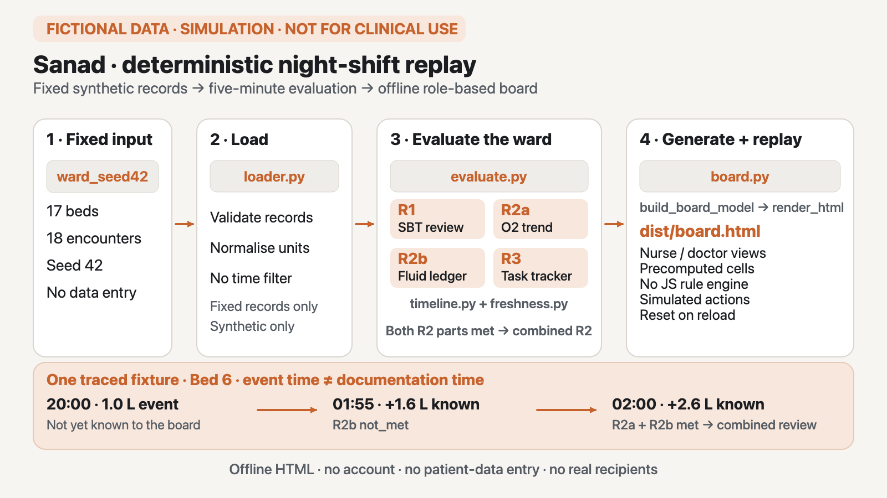

# Sanad

> **FICTIONAL DATA · SIMULATION · NOT FOR CLINICAL USE**

**On the fixed fictional night, the rules were met 657 times; Sanad sent 11 messages: one per episode.**

*Software behaviour on fictional data, not a clinical result.* 657 of 9,848 rule checks came back `met`; the board raised 9 messages for the on-call doctor and 2 for the night nurse. Source: [`eval/results/alert-burden.json`](eval/results/alert-burden.json), checked by [`scripts/alert_burden.py`](scripts/alert_burden.py) and [`tests/test_alert_burden.py`](tests/test_alert_burden.py).



Watch the [2:49 demo video](https://youtu.be/2LObw4ZvmOE), open the [live board](https://drahmed7887.github.io/sanad-public/) (no install or account), inspect the [public repository](https://github.com/DrAhmed7887/sanad-public), or read [`JUDGES.md`](JUDGES.md) and [`CLAIMS.md`](CLAIMS.md). Built with Kiro for **Kiroween 2026 (Frankenstein category)** using the Python 3.12 standard library, HTML, CSS, and vanilla JavaScript.

```bash
python3 -I scripts/alert_burden.py --check
```

## Intended use

> Offline software demonstration using fictional adult ICU scenarios. Illustrates configurable rules and notification workflows. Not intended to monitor people, assess SBT readiness, detect deterioration, prioritise clinical care, or support diagnosis or treatment. Do not enter patient data. No clinical performance has been established.

This statement is reproduced verbatim from the signed [rules baseline](docs/EVIDENCE.md).

## Alert fatigue

Two published findings motivate Sanad's episode grouping and routing; neither studied Sanad.

- **ICU monitor alarms:** Drew et al. counted 381,560 audible alarms across 461 adult ICU patients, an average burden of **187 alarms/bed/day** (*PLoS One* 2014, [doi:10.1371/journal.pone.0110274](https://doi.org/10.1371/journal.pone.0110274)).
- **Repeated reminders:** Among 112 primary-care clinicians, reminder acceptance dropped by **30% per additional reminder** per encounter (Ancker et al., *BMC Med Inform Decis Mak* 2017, [doi:10.1186/s12911-017-0430-8](https://doi.org/10.1186/s12911-017-0430-8)).

Every design response below is a software property checked by tests on fictional data:

| Driver | Sanad's answer | Checked by |
|---|---|---|
| Repeats of one condition | **One message per episode.** Consecutive `met` grid points emit one item. | PBT-4 in [`tests/test_pbt.py`](tests/test_pbt.py); [`eval/results/alert-burden.json`](eval/results/alert-burden.json) |
| Wrong-role routing | **Role separation.** R3 overdue checks and feed alerts go to the nurse inbox; R1/R2 go to the doctor list. | `board.NURSE_RULES` / `board.DOCTOR_RULES`; `tests/test_board_model.py` |
| Split bed alerts | **R2a + R2b share one doctor item.** Both `met` show the approved combined message. | `board.EPISODE_GROUPS` (D28); `tests/test_board_model.py` |
| Premature closure | **Acknowledge is not completion.** R3 stays `met` and open until a valid check is documented. | PBT-7 in [`tests/test_pbt.py`](tests/test_pbt.py); `tests/test_r3.py` |
| Silent data outages | **Stale feeds raise a visible alert.** Observations > 15 min old become `unknown` (`stale_data`) plus a feed alert. | PBT-9 in [`tests/test_pbt.py`](tests/test_pbt.py); `tests/test_board_order_actions.py` |
| Unbounded snoozes | **Deferrals carry reason, owner, and expiry.** Re-evaluation runs at expiry (Bed 15 at 01:30). | `tests/test_r1.py`; `tests/test_board_browser.py` |

## Generate and open the local demo

Requires **Python 3.12** (`python3 --version`). Generate the self-contained HTML board (`dist/` is git-ignored) and open it directly in a desktop browser:

```bash
PYTHONPATH=src python3 -m sanad.board --out dist/board.html
open dist/board.html
```

Screen 1 opens directly on the 17-bed live ward status, alarm-fatigue stake, role views (**Night nurse view**, **On-call doctor view**), three one-click scenario jumps (**Bed 1 R1 @ 22:20**, **Bed 6 Late Fluid @ 02:00**, **Bed 9 Stale Feed @ 01:15**), and the **Test Custom Bed State** live sandbox. Detailed flows live in [`docs/WALKTHROUGHS.md`](docs/WALKTHROUGHS.md).

## Architecture and verification

Sanad separates pure Python 3.12 rule evaluation (`src/sanad/r1.py`, `r2a.py`, `r2b.py`, `r3.py`, `evaluate.py`) from the offline HTML viewer (`src/sanad/board.py`), which embeds precomputed cells and a sandbox simulation. See [`docs/ARCHITECTURE.md`](docs/ARCHITECTURE.md) for the pipeline diagram, Kiro specs/hooks, and test setup, [`DATA_CARD.md`](DATA_CARD.md) for dataset provenance, and [`data/SCENARIOS.md`](data/SCENARIOS.md) for the 17-bed oracle.

```bash
python3 -I data/check_data.py && python3 -I scripts/alert_burden.py --check && python3 -m pytest -q
```

## Limits

These results describe deterministic software behavior on one fixed synthetic night (`data/ward_seed42/`):

- **One fixed night:** 17 beds and 18 hand-built encounters; it does not predict real ward message volume.
- **657 is not a clinical baseline:** It counts `met` grid checks, not a comparison against an existing clinical product.
- **No staff evaluation:** Alert fatigue, workload, response time, and patient outcomes were not measured.
- **No escalation:** An open episode remains one message without escalation steps.
- **Known discrepancies:** Bed 13's first encounter keeps 60 `met` R2b results after 23:00 discharge (excluded from the 657 count; backlog B3), and loader validation for deferral fields is tracked in backlog B4 ([`docs/JUDGING_GUIDE.md`](docs/JUDGING_GUIDE.md)).
- **Offline demonstration only:** No patient-data upload, live feed, or clinical validation; R2a/R2b thresholds are DESIGN demo values.

## License

[MIT](LICENSE).
